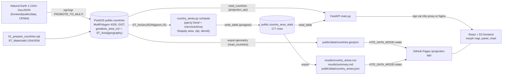

# Project 1, Projection Lab: report evidence

Collected 2026-10-29 by the `report-evidence` skill. Source material, not prose.

Markers:
- **[re-run]**: confirmed by running code on 2026-10-29. Scratch script: `p1_check.py` in the session scratchpad, not committed. It reads `results/country_areas.csv`, `frontend/public/data/*.json|geojson` and calls `country_areas.calculate_country_areas()`.
- **[docs]**: taken from READMEs, PROGRESS.md or commit messages and not re-run (most need the PostGIS database, which this session did not start).
- **UNVERIFIED**: could not be confirmed.

Paths are relative to `Project 1/` unless they start with `.github/`, `scripts/` or `report/`.

## 1. Objective and motivation

- Purpose: a small GIS web app that compares Mercator and Eckert IV in one interactive morphing map and uses country shapes and areas to explore cartographic distortion, including Greenland vs Africa. (`README.md` §Purpose)
- The single morphing map replaced the original side-by-side proof of concept at the learner's request on 2026-09-09. (`README.md` §Purpose; `PROGRESS.md` 2026-09-09)
- Research question (sprint, 2026-10-27): "How much does the Mercator projection inflate country areas, how does that depend on latitude, and how well does the theoretical Mercator area scale factor sec²(φ) predict it compared with an equal-area projection (Eckert IV)?" (`README.md` §Current State; `report/SPRINT.md` session 1)
- Learning purpose: rebuild hands-on coding fluency, practise debugging, and build a habit of reading official docs. (`README.md` §Purpose)
- Learning goals: D3 projections; projection distortion, Tissot's indicatrix, geodesic vs planar area; PostGIS geometry vs geography, spatial indexing, GeoJSON export; FastAPI; pyproj reprojection and CRS consistency; Docker. (`README.md` §Learning Goals)
- Who benefits: the learner (stated). A general audience is implied by the 2026-10-27 Method section "written for non-experts". (`PROGRESS.md` 2026-10-27 Method Explanation) An explicit target audience beyond that is missing.
- Course framing: Project 1 is the GI Science project of TBA4565. (root `CLAUDE.md`; `report/SPRINT.md` table)

## 2. GIS concepts

The GI Science / GI Systems classification is my judgement unless the docs say otherwise. The course labels Project 1 as a whole "GI Science". (root `CLAUDE.md`)

- **Map projections: Mercator (conformal cylindrical) vs Eckert IV (equal-area pseudocylindrical).** These are the two endpoints of the map. The backend projects every country with PROJ `+proj=merc` and `+proj=eck4` on a sphere. GI Science. (`backend/country_areas.py` L22–31; `frontend/src/App.tsx` L46–79)
- **Projection morphing.** The frontend blends the two raw projections by linear interpolation of the raw coordinates (`(1−t)·merc + t·eck4`) and fits each blend to the frame with `fitExtent`. Intermediate blends preserve neither area nor angles and are not measured. GI Science (cartographic visualisation). (`App.tsx` L46–79; `README.md` L149)
- **Tissot's indicatrix (finite approximation).** 30 geographic circles of 3° radius (`geoCircle().radius(3).precision(2)`) at latitudes −60/−30/0/30/60 and longitudes −150…150 are drawn through the current projection. They are a finite stand-in for the infinitesimal indicatrix. GI Science. (`App.tsx` L35–44; `README.md` Limitations)
- **Area scale factor sec²φ.** On the sphere, Mercator scales lengths by sec φ in both directions, so the local area scale is sec²φ. The project computes sec²(φc) at each country's centroid and compares it with the measured ratio. GI Science. (`results/summary.md` §Why; `backend/README.md` §Centroid latitude, citing Snyder 1987 ch. 7)
- **Jensen's inequality.** A country's Mercator ratio is the area-weighted mean of sec²φ. sec²φ = 1/(1−s²) is convex in s = sin φ, so mean ≥ sec²(φc), which explains why the centroid prediction always underestimates. GI Science (analysis). (`results/summary.md`; test `test_tall_polygon_exceeds_sec2_at_centroid`)
- **Area-weighted centroid latitude via the cylindrical equal-area projection.** φc = asin(ȳ/R), where ȳ is the planar centroid in `+proj=cea` (y = R sin φ, equal-area). This avoids the poleward bias of a lon/lat centroid and is safe across the antimeridian. GI Science. (`country_areas.py` L145–152; `backend/README.md` §Centroid latitude)
- **Earth models: sphere vs ellipsoid; geodesic vs planar area.** Projection ratios use a sphere of R = 6,371,007.1809 m (≈ WGS 84 authalic radius). PostGIS stores a separate WGS 84 ellipsoidal area (`ST_Area(geom::geography)`). Planar area of EPSG:4326 geometry is in square degrees. GI Science. (`country_areas.py` L15; `database/01_prepare_countries.sql`; `database/README.md` §Measurement Limits)
- **Great-circle boundary model and densification.** Boundaries are read as great-circle arcs and densified with `Geod(a=R, f=0).npts` to 20/10/5 km segments as a convergence check. The new clip edges are densified along the parallel instead, because a parallel is not a great circle. GI Science (computational geometry). (`country_areas.py` L66–90, L174–209)
- **Mercator latitude limit and polar clipping.** The limit is atan(sinh π) = 85.0511287798066° (Web Mercator). Geometry beyond it is clipped in latitude only, which affects Antarctica alone. The frontend instead *clamps* latitude to the same limit for drawing. GI Science / GI Systems. (`country_areas.py` L17, L119–133; `App.tsx` L55–59) [re-run: limit value printed]
- **Antimeridian handling.** Natural Earth splits Fiji, Russia and Antarctica at ±180°. The clip uses x = ±360 so that densified ±180° edges survive. A test checks that a box against 180° gives the same ratios as the box shifted to 0°. GI Systems. (`backend/README.md` §Antimeridian; `test_antimeridian_edge_matches_shifted_polygon`)
- **CRS / EPSG codes and axis order.** Data is stored in EPSG:4326 (`geometry(MultiPolygon,4326)`). The source GeoJSON declares `urn:ogc:def:crs:OGC:1.3:CRS84`, whose coordinates are lon/lat. pyproj uses `always_xy=True`. The PROJ strings are `+proj=longlat +R=…`, `+proj=merc +R=… +units=m`, `+proj=eck4 …` and `+proj=cea …`. GI Systems. (`database/01_prepare_countries.sql`; `database/README.md` §2; `country_areas.py` L22–31) [re-run: CRS84 member read from the source file]
- **PostGIS geometry vs geography.** `geom::geography` switches `ST_Area` from square degrees to spheroidal m². GI Systems. (`database/README.md` §Measurement Limits)
- **Spatial index and spatial predicate.** GiST index on `geom`. An `ST_Covers` point-in-country query for Berlin (13.405, 52.52) returned DEU and used `countries_geom_geom_idx` in `EXPLAIN (ANALYZE, BUFFERS)`. GI Systems. (`database/README.md` §Current State; `PROGRESS.md` 2026-09-09) [docs]
- **Geometry validity and repair.** USA and Sudan self-intersections were repaired with `ST_MakeValid` inside a guarded transaction. Separately, Sudan's ring is valid with straight lon/lat edges but self-intersects once its edges are treated as great circles (projected-geometry flag). GI Systems. (`database/01_prepare_countries.sql`; `backend/README.md` §Sudan)
- **GeoJSON and winding order.** The API keeps D3's convention (clockwise exteriors) and does not normalise to RFC 7946's counter-clockwise recommendation. The backend orients an in-memory copy counter-clockwise so that pyproj's signed area is positive. GI Systems. (`backend/README.md` §Endpoints, §Country Method step 2; `database/README.md` §6)
- **Cartographic generalisation.** All areas describe Natural Earth 1:110m boundaries, not official national figures. GI Science. (`README.md` Limitations)
- **Web GIS architecture.** PostGIS → FastAPI → React/D3, plus a static-snapshot mode for GitHub Pages. GI Systems. (`README.md` §Run the Map, §Static Data Mode)

## 3. Data

### 3.1 Natural Earth Admin 0 Countries, 1:110m (the only input dataset)

- **Source / URL:** <https://www.naturalearthdata.com/downloads/110m-cultural-vectors/110m-admin-0-countries/>, downloaded as GeoJSON from <https://github.com/nvkelso/natural-earth-vector/blob/master/geojson/ne_110m_admin_0_countries.geojson>. (`frontend/README.md` §Data Source)
- **Licence:** public domain (<https://www.naturalearthdata.com/about/terms-of-use/>). (`frontend/README.md` §Data Source)
- **Version / download date:** missing. The file has no version property, and the commit date (52d5b2d, 2026-09-09) is only when it was committed. [re-run: no `*VER*` property found among the 168 feature properties]
- **File:** `frontend/public/data/ne_110m_admin_0_countries.geojson`, versioned in the repo and used as the import source. (`database/README.md` §2)
- **Features:** 177. [re-run]
- **CRS:** declared `urn:ogc:def:crs:OGC:1.3:CRS84` [re-run]. ogrinfo reports WGS 84 / EPSG:4326 with data axis mapping 2,1, i.e. lon, lat [docs]. Extent (−180, −90) to (180, 83.64513) [docs]. (`database/README.md` §2)
- **Format:** GeoJSON with mixed Polygon/MultiPolygon. ogrinfo reports `Unknown (any)`. (`database/README.md` §2)

**Preprocessing, in order:**
1. `ogr2ogr` import into `public.countries`. Flags: `-nlt PROMOTE_TO_MULTI`; `-select NE_ID,ADMIN,ADM0_A3,NAME,CONTINENT`; `GEOMETRY_NAME=geom`; GiST index. Compose also sets `FID=ogc_fid`. (`database/README.md` §2; `database/bootstrap/import.sh`)
2. `01_prepare_countries.sql`, in one transaction:
   - guard checks: 177 rows, MultiPolygon/4326, exactly one USA and one SDN, no other invalid features;
   - tighten the column to `geometry(MultiPolygon,4326)`;
   - `ST_MakeValid` on invalid USA/SDN only;
   - re-validate;
   - add the stored generated column `geodesic_area_m2 = ST_Area(geom::geography)`;
   - check that every area is positive and finite.
   (`database/01_prepare_countries.sql`)
3. `country_areas.py compute` reads each geometry with `ST_AsGeoJSON(geom, 15)`, computes the statistics and writes `public.country_area_stats`. The database geometry is not modified. (`country_areas.py` L287–321)

**Known quality issues:**
- USA and SDN were invalid on import and repaired. The repair does not establish authoritative boundaries. (`database/README.md` §3)
- SDN has a narrow spike near (24.57°E, 8.23°N) that self-intersects as great circles. A `make_valid` repair would change its area by 4.95e-7 (Mercator) and 5.26e-7 (Eckert IV) relative. It is flagged but kept. (`backend/README.md` §Sudan) [docs; the flag itself re-run, see §6]
- Generalised 1:110m boundaries, not official areas. (`README.md` Limitations)
- Only Antarctica extends past ±85.0511°: it reaches −90°. (`backend/README.md` §Poles) [re-run: only ATA has `is_clipped=True` in the CSV]

### 3.2 Derived datasets (outputs, all generated by code)

- `public.country_area_stats`: 24 columns, one row per country, 177 rows. (`database/04_create_country_area_stats.sql`; `PROGRESS.md` 2026-10-27 step 2) [docs]
- `results/country_areas.csv`: 177 rows plus a header, 23 columns, full float precision. (`country_areas.py write_csv`) [re-run: 177 rows]
- `results/summary.md`: generated by `export` and dated 2026-10-27. (`results/summary.md`)
- `frontend/public/data/country_areas.json`: 177 records in the API shape. [re-run: 177 records; `merc.area_ratio` equals the CSV's `merc_ratio` exactly for all 177]
- `frontend/public/data/countries.geojson`: 177 features, the `/countries` response, written by `export-geometry`. It contains the repaired geometry and `ST_AsGeoJSON`'s default precision. [re-run: 177 features; 262,508 bytes in the CRLF working copy; served as 262,507 bytes on Pages, because the index holds LF; `git ls-files --eol` shows `i/lf w/crlf`]

## 4. Architecture and stack

- **Frontend:** React 19.2.8, TypeScript 6.0.3, Vite 8.2.2, d3-geo 3.1.1, d3-geo-projection 4.0.0, d3-scale 4.0.2. One SVG map plus `DistortionChart.tsx`. No chart library. [re-run: versions from `frontend/package-lock.json`]
- **Backend:** Python 3.14.7, FastAPI 0.141.1, Psycopg 3.3.6, pyproj 3.8.0 (PROJ 9.8.1), Shapely 2.1.2 (GEOS 3.13.1), pytest 9.1.1 (dev). Managed by uv. [re-run: `uv.lock` plus a runtime print of the PROJ/GEOS versions on Windows]
- **Database:** PostgreSQL 18.6 + PostGIS 3.6.2 natively; Compose image `postgis/postgis:18-3.6`, PostGIS 3.6.4 in the fresh replay. (`database/README.md`; `compose.yaml`) [docs]
- **Import tooling:** GDAL 3.13.3 (OSGeo4W natively; `ghcr.io/osgeo/gdal:ubuntu-small-3.13.3` in Compose). (`database/bootstrap/Dockerfile`)
- **Compose services:**
  - `db` on 127.0.0.1:5433;
  - `bootstrap` (setup profile, one-shot, refuses to run if `public.countries` exists);
  - `areas` (setup profile, runs `country_areas.py compute` as `postgres`);
  - `api` on 127.0.0.1:8000 (role `projection_api`, read-only);
  - `web` (Nginx 1.29, 127.0.0.1:8080, proxies `/api/` → `api:8000/`).
  (`compose.yaml`; `frontend/nginx.conf`)
- **Data-source switch:** `VITE_DATA_MODE=static` swaps `/api/countries` and `/api/countries/areas` for `./data/countries.geojson` and `./data/country_areas.json`. Vite `base: './'`. (`frontend/src/dataSource.ts`; `vite.config.ts`) [re-run: the static bundle contains `./data/${e}` with `countries.geojson`/`country_areas.json` and 0 occurrences of `/api/`]
- **Pages build:** `npm run site:build` (`scripts/build-site.mjs`) builds Project 1 into `dist-site/projection-lab/` in static mode. `.github/workflows/pages.yml` deploys it. (`scripts/build-site.mjs` L3, L20–22)
- **Endpoints:**
  - `/health`: process only, no database check;
  - `/countries/count`;
  - `/countries`: a FeatureCollection;
  - `/countries/areas`;
  - `/countries/{adm0_a3}/areas`: case-insensitive; 404 for an unknown code; 503 if the table is missing.
  (`backend/main.py`)

## 5. Methods and workflow

**Per-country calculation (`calculate_country_areas`, `country_areas.py` L159–227):**
1. Orient to counter-clockwise exteriors and promote to MultiPolygon. Reject invalid or empty input.
2. Unclipped spherical reference area: `Geod(a=R,f=0).geometry_area_perimeter`.
3. Decide on clipping: is any |lat| > 85.0511°?
4. For each segment spacing of 20, 10 and 5 km:
   - great-circle densify, then clip if needed and densify the clip edges along the parallel;
   - project to merc and eck4;
   - Shapely planar area.
5. Ratio = 5 km projected area / spherical reference. The reference is the clipped geometry's spherical area when the country was clipped.
6. Convergence is the 10→5 km relative change, which must be < 1e-5. The 20→10 km change is also stored.
7. Status flags: `not_converged`, `eck4_ratio_outside_tolerance`, `merc_ratio_not_above_1`, `invalid_geometry`, `invalid_area`.
8. Centroid latitude via cea, plus sec²(φc) and ratio/sec².

**Reproduce, from the repo root (PowerShell). Commands from the READMEs:**
1. `Copy-Item "Project 1/.env.example" "Project 1/.env"`, then set both passwords. (`README.md` §Docker Compose)
2. `docker compose --env-file "Project 1/.env" -f "Project 1/compose.yaml" up -d db`
3. `docker compose --env-file "Project 1/.env" -f "Project 1/compose.yaml" --profile setup run --build --rm bootstrap`. This runs ogr2ogr, then 00, 01, 03 and 04.
4. `docker compose --env-file "Project 1/.env" -f "Project 1/compose.yaml" --profile setup run --build --rm areas`. This runs `compute`.
5. `docker compose --env-file "Project 1/.env" -f "Project 1/compose.yaml" up -d --build web`, then open <http://127.0.0.1:8080>.
6. Exports (need the database): `uv run --locked --project "Project 1/backend" "Project 1/backend/country_areas.py" export` and `… export-geometry`. (`backend/README.md`; `README.md` §Static Data Mode)
7. Static build: `$env:VITE_DATA_MODE = "static"; npm --prefix "Project 1/frontend" run build; Remove-Item Env:VITE_DATA_MODE`, or `npm run site:build` for the whole site. (`README.md` §Static Data Mode)
8. Fresh-volume replay: the `compose.replay.yaml` sequence with `-p projection-replay`. (`database/README.md` §Fresh-Volume Replay)
9. Tests: `uv run --locked --project "Project 1/backend" pytest`.
10. Dry run without writing: `uv run --locked country_areas.py compute --dry-run --only GRL ATA`. (`backend/README.md`)

**Database-free reproduction (done in this session):** `calculate_country_areas()` over `frontend/public/data/countries.geojson` (the repaired geometry) reproduces the CSV. See §6. [re-run]

**History (git):**
- 52d5b2d, 2026-09-09: phase 1–2 maps.
- 974488a, 2026-09-09: phase 3 PostGIS.
- 71e5995, 2026-09-21: phase 4 FastAPI and Greenland areas.
- 12ae602, 2026-09-30: phase 5 Compose.
- e4465cd, 2026-10-27: all-country module and tests.
- b993fa3, 2026-10-27: stats table.
- 9104e9b, 2026-10-27: endpoints.
- 08c3234, 2026-10-27: exports.
- 068f04d, 2026-10-27: selection and chart.
- d56bea5, 2026-10-27: CI.
- 708ee2d, 2026-10-27: replay.
- 0b4d0b6, 84755f6 and 098ed66, 2026-10-27: Method text, accessibility, review fixes.
- 4f06706, 2026-10-28: static mode.
- 68dbf91 and f2fe54c, 2026-10-28: home link and favicon.
- 214b1ad and 2bc2312, 2026-10-28: docs and deployment record.
(`git log --stat -- "Project 1"`)

## 6. Results

All numbers below exclude the clipped Antarctica, n = 176, unless stated otherwise. Each was recomputed from `results/country_areas.csv` on 2026-10-29. [re-run]

- **Coverage:**
  - 177 countries computed;
  - status not `ok`: only SDN, `merc_invalid_geometry,eck4_invalid_geometry`;
  - clipped: only ATA, with kept fraction 0.9226783 (92.27%) and a clipped Mercator ratio of 25.523775.
  [re-run; matches `results/summary.md`]
- **Mercator ratio:**
  - median 1.2062806 (1.2063);
  - maximum 16.5432619 (GRL);
  - second 9.3798172 (NOR; the docs attribute this to Svalbard, which reaches 80.7°N);
  - minimum 1.0007020 (GAB).
  [re-run]
- **Five most inflated:** GRL 16.5433, NOR 9.3798, ISL 5.6367, FIN 5.4650, CAN 5.2127. (`results/summary.md`) [GRL and NOR re-run; the rest from the generated summary, not re-checked individually]
- **Eckert IV:** the largest |ratio − 1| is 2.4864925e-6 (LUX), including ATA. [re-run]
- **Ratio / sec²(φc):**
  - median 1.0010435; minimum 1.0000095; maximum 1.5964379 (NOR);
  - within 1%: 156 of 176; within 10%: 169 of 176;
  - countries with a ratio < 1: 0, which is consistent with Jensen.
  [re-run]
- **Largest gaps:** NOR 1.5964, GRL 1.5721, CAN 1.4955, USA 1.2672, RUS 1.2573. Each spans at least 22.6° of latitude. (`results/summary.md`) [NOR re-run; the rest from the generated summary]
- **Convergence (10→5 km), all 177 countries:**
  - largest Mercator change 6.4509686e-6 (GRL); largest Eckert IV change 9.3107871e-6 (LUX), close to the 1e-5 tolerance;
  - the 20→10 km changes exceed 1e-5 (Eckert IV LUX 1.82e-5; Mercator GRL 1.98e-5), so 20 km alone would not pass.
  [re-run]
- **Ellipsoid vs sphere:** ellipsoidal area / unclipped spherical area − 1 ranges from −0.446% (GAB) to +0.815% (ATA). [re-run; the docs round this to −0.45% / +0.81%]
- **Greenland:**
  - ellipsoidal area 2,206,644.439 km²; spherical area 2,189,750.321 km²;
  - Mercator area 36,225,613.004 km², ratio 16.543261873210085;
  - Eckert IV area 2,189,749.778 km², ratio 0.9999997520352772, i.e. 0.543 km² below the sphere;
  - convergence changes: Mercator 6.45097e-6, Eckert IV 5.87293e-7;
  - centroid latitude 72.0451°, sec²(φc) 10.5231;
  - the ellipsoid − sphere difference is 16,894.1 km², which is 0.766% of the ellipsoidal area.
  [re-run from the CSV; `test_greenland_matches_documented_results` passes]
- **Cross-platform agreement:**
  - Greenland's Mercator ratio was 16.543261873210085 natively on Windows and 16.543261873210074 in the Linux container [docs];
  - the fresh Compose replay matched the CSV within a maximum relative difference of 1.1e-13 (largest: ATA's `sec2_at_centroid`, 1.119e-13) [docs; the comparison script is not committed];
  - recomputing without a database from `countries.geojson` matched the CSV within 1.84e-13 relative (Mercator ratio, USA) and exactly for every Eckert IV ratio, with identical statuses and SDN still flagged [re-run].
- **Runtime:**
  - full 177-country recompute from GeoJSON: 0.58 s, single run on 2026-10-29, not a benchmark [re-run];
  - dry run against the database: about 1.8 s [docs].
- **Theory spot values:** sec²60° = 4 and sec²80° = 33.163. [re-run: arithmetic]
- **Database facts:**
  - Greenland geography area ≈ 2,206,644,439,414.82 m², which matches the CSV's `ellipsoidal_area_m2` [re-run for the CSV value];
  - Berlin `ST_Covers` → DEU in 0.110 ms, a single run [docs only];
  - `projection_api` has SELECT t / INSERT f on `country_area_stats` [docs].
- **Static GeoJSON export:** 177 features. `main.get_countries() == json.load(countries.geojson)` returned `True`. [docs; feature count re-run]
- **Accessibility measurements:** minimum text contrast 5.30:1; chart point fill 3.79:1; outline 5.72:1; sec² curve 5.76:1; selected border 4.51:1. (`frontend/README.md` §Accessibility) UNVERIFIED in this session.
- **Africa:** no Africa statistic was calculated. Africa is educational context only. (`backend/README.md` §Interpreting)

## 7. Verification

**Re-run on 2026-10-29 (Windows, Node 24, uv):**
- `uv run --locked --project "Project 1/backend" pytest`: `12 passed in 2.32s` (Python 3.14.7, pytest 9.1.1).
- `npm --prefix "Project 1/frontend" run lint`: exit 0, no findings.
- `npm --prefix "Project 1/frontend" run build`: exit 0 (337 modules; JS 248.61 kB / 81.79 kB gzip).
- `VITE_DATA_MODE=static npm --prefix "Project 1/frontend" run build`: exit 0 (JS 248.77 kB). The bundle references `./data/` and has no `/api/`.
- The live site <https://progrimm.github.io/TBA4565-Geomatics-Specialization-Course/projection-lab/> returns HTTP 200; `data/countries.geojson` returns 200 (262,507 B); `data/country_areas.json` returns 200 (222,454 B; the local CRLF copy is 229,536 B, a 7,082 B line-ending difference). `curl` checked status only, not rendering.
- Database-free recompute of all 177 countries matches the CSV (§6).

**Test suite** (`backend/tests/test_country_areas.py`), 12 tests:
- the octant has area πR²/2 (rel 1e-12);
- the Eckert IV ratio of a 10°×10° box is 1 within 1e-5;
- 0.1° boxes at 0/30/45/60/75° give a ratio of sec²φ within 1e-3 (5 parametrised cases);
- a 10–70° box gives a ratio > 1.2·sec²(φc);
- antimeridian symmetry;
- a polar cap is clipped, and its area equals the zone formula within 1e-5;
- geometry entirely beyond the limit is rejected;
- a Greenland regression against the source GeoJSON.

**CI:** `.github/workflows/project1-ci.yml`, path-filtered:
- the frontend job runs `npm ci`, lint and build (Node 24);
- the backend job runs `uv sync --locked` and pytest (Python 3.14), with no database;
- it passed on GitHub on 2026-10-28, run 40763110611, and the Pages deploy passed, run 40763110583 (`PROGRESS.md` 2026-10-28) [docs; not re-checked via `gh`];
- actionlint passed locally (`PROGRESS.md` 2026-10-27 CI) [docs].

**Manual and ad hoc browser checks (Playwright scripts not committed)** [docs]:
- 39/39 interaction checks at 1600 px (mouse) and 390 px (touch). (`frontend/README.md` §Verification Recorded)
- 34/34 accessibility checks at 1600, 390 and 320 px, after the code review. (`frontend/README.md`; `PROGRESS.md` 2026-10-27 review)
- Static build under `/projection-lab/`: 177 paths, 0 console errors, 0 failed requests at 1600 and 390 px. Live-site round trip at 1600 and 390 px passed. (`PROGRESS.md` 2026-10-28)
- Screenshots were inspected, and bugs were found from them: the tooltip covering its point, and colliding x-labels at 320 px. (`PROGRESS.md`)

**Database checks** [docs]:
- 177/0/0/0 total/missing/empty/invalid after repair;
- `02_verify_countries.sql` is read-only and reports values but does not assert them;
- the fresh-volume Compose replay on 2026-10-27 matched (§6).
(`database/README.md`)

**API checks** [docs]: run through FastAPI TestClient and HTTP (GRL 15 fields bit-for-bit, `grl` → 200, `XXX` → 404, simulated missing table → 503), but ad hoc; no API tests are committed. (`backend/README.md` §Verification)

**Not re-run here:** anything that needs PostGIS or Docker (Docker Desktop state unknown), the Playwright suites, and the browser screenshots.

## 8. Limitations, assumptions and uncertainties

**Acknowledged in the docs:**
- The Pages site is a snapshot. Regenerating it needs the database (`export-geometry`). (`README.md` Limitations)
- The Compose images were not rebuilt after the relative `base` change on 2026-10-28. (`README.md`; `PROGRESS.md`)
- CI has been observed only once. (`README.md`)
- Generalised 1:110m boundaries including the database repairs; not official figures. (`README.md`)
- Sphere, not ellipsoid, for the ratios. The ellipsoid differs by −0.45% to +0.81%. (`README.md`)
- Antarctica is clipped at ±85.0511° and excluded from the statistics. (`README.md`)
- Sudan carries a projected-validity flag with an area effect of about 5e-7. (`README.md`)
- Blends are not measured and fitted independently, so screen area is not comparable across slider positions. (`README.md`)
- The 3° circles only approximate Tissot's indicatrix. (`README.md`)
- The map SVG itself is not keyboard-navigable, and no screen reader (NVDA/VoiceOver) was tested. (`README.md`)
- Browser tests are not committed and do not run in CI. (`README.md`)
- Windows and Linux results differ by about 1e-13 because of PROJ/GEOS builds. (`README.md`)
- The native (OSGeo4W) setup has not been replayed end to end. (`README.md`; `database/README.md`)
- API hardening: other database errors return a generic 500, and there is no connection pool. (`README.md`)
- The frontend clamps Mercator latitude for drawing rather than clipping it geographically. (`README.md` L149)
- `npm audit` reports 4 high findings in dev tooling and 0 with `--omit=dev`. Not fixed. (`frontend/README.md`) [docs; not re-run]
- The empty-array fallback of the `/countries` SQL was never tested against an empty table. (`database/README.md` §6)
- The default `PUBLIC` rights were not revoked, and no full privilege audit was done. (`database/README.md` §5)
- Convergence passing is evidence of numerical stability, not an error bound for the boundaries. (`backend/README.md`)

**Spotted in the code or data during this collection (not in the docs):**
- `GET /countries/{code}/areas` against an existing but *empty* table returns 404, not 503: `read_area_stats` only checks for emptiness when `code is None`. The docs say "a missing or empty table returns 503", which holds only for `/countries/areas` and for a missing table. (`backend/main.py` L28–48)
- The convergence check covers only the 10→5 km step. Eckert IV LUX reaches 9.31e-6, close to the 1e-5 threshold, and the 20→10 km changes are above 1e-5. [re-run]
- For ATA, `ellipsoidal_area_m2` is the *unclipped* WGS 84 area while `spherical_area_m2` is clipped, so the two are not like for like in the panel. (`country_areas.py` L188–196)
- The static `countries.geojson` uses `ST_AsGeoJSON` default precision (`read_countries`, no digits argument), while `compute` reads 15 digits. The map geometry is therefore rounded relative to the computed geometry. Measured effect on the recomputed ratios: ≤ 1.84e-13 relative. [re-run]
- The Greenland regression test reads the *unrepaired* source GeoJSON, not the database geometry. That is fine for GRL, which was not repaired, but no test covers the repaired USA/SDN geometries, the database layer or the endpoints. (`tests/test_country_areas.py` L17–23)
- The dataset's Natural Earth version and download date are not recorded. (§3.1)
- `summary.md` carries `date.today()`, so any re-export rewrites its date. This is why `export-geometry` is a separate command. (`country_areas.py` L389; `backend/README.md`)
- The working-copy data files are CRLF (git `core.autocrlf=true`) and LF in the index, so local and served byte sizes differ. Cosmetic. [re-run]
- sec²(φc) as a predictor is a one-point approximation by design. Its error grows with latitude span and is driven by remote territories (Svalbard, Alaska/Hawaii). (`results/summary.md`)

## 9. Future work

From the docs (`README.md` Limitations; `PROGRESS.md` §Current Checkpoint "Remaining"; `backend/README.md` §Remaining work):
- rebuild and re-check the Compose images after the `base` change;
- commit the Playwright browser tests and run them in CI;
- replay the native (OSGeo4W) setup end to end;
- specific HTTP errors for other database failures, and a connection pool;
- no intermediate-blend area calculation exists (stated as not done);
- QGIS database visualisation and a full privilege audit remain unverified (`database/README.md` §Measurement Limits);
- "Next action: write the report from `results/summary.md` and the chart." (`PROGRESS.md`)

Not stated in the docs: an ellipsoidal (rather than spherical) projection comparison, other equal-area or compromise projections, and a finer-scale (1:10m) dataset. Missing as planned work.

## 10. References

Only links already cited in Project 1 files (`git ls-files "Project 1"` grep), plus the course site.

**Datasets:**
- Natural Earth Admin 0 Countries 1:110m: <https://www.naturalearthdata.com/downloads/110m-cultural-vectors/110m-admin-0-countries/>
- Natural Earth vector repo GeoJSON: <https://github.com/nvkelso/natural-earth-vector/blob/master/geojson/ne_110m_admin_0_countries.geojson>
- Natural Earth terms of use: <https://www.naturalearthdata.com/about/terms-of-use/>

**Literature:**
- Snyder, J. P. (1987). *Map Projections: A Working Manual*. USGS Professional Paper 1395: <https://pubs.usgs.gov/pp/1395/report.pdf>

**Projection and geometry libraries:**
- PROJ Mercator: <https://proj.org/en/stable/operations/projections/merc.html>
- PROJ Eckert IV: <https://proj.org/en/stable/operations/projections/eck4.html>
- PROJ cylindrical equal area: <https://proj.org/en/stable/operations/projections/cea.html>
- pyproj Geod: <https://pyproj4.github.io/pyproj/stable/api/geod.html>
- pyproj Transformer: <https://pyproj4.github.io/pyproj/stable/api/transformer.html>
- Shapely transform: <https://shapely.readthedocs.io/en/stable/reference/shapely.transform.html>
- Shapely clip_by_rect: <https://shapely.readthedocs.io/en/stable/reference/shapely.clip_by_rect.html>

**PostGIS, PostgreSQL and GDAL:**
- PostGIS ST_AsGeoJSON: <https://postgis.net/docs/ST_AsGeoJSON.html>
- PostGIS ST_Area: <https://postgis.net/docs/ST_Area.html>
- PostGIS ST_Covers: <https://postgis.net/docs/ST_Covers.html>
- PostGIS ST_MakeValid: <https://postgis.net/docs/ST_MakeValid.html>
- PostGIS Windows install: <https://postgis.net/documentation/getting_started/install_windows/>
- PostgreSQL generated columns: <https://www.postgresql.org/docs/current/ddl-generated-columns.html>
- PostgreSQL EXPLAIN: <https://www.postgresql.org/docs/current/sql-explain.html>
- libpq password file: <https://www.postgresql.org/docs/current/libpq-pgpass.html>
- PostgreSQL Windows download: <https://www.postgresql.org/download/windows/>
- GDAL ogr2ogr: <https://gdal.org/en/stable/programs/ogr2ogr.html>
- GDAL PostgreSQL driver: <https://gdal.org/en/stable/drivers/vector/pg.html>
- QGIS download: <https://qgis.org/download/>

**Backend:**
- FastAPI first steps: <https://fastapi.tiangolo.com/tutorial/first-steps/>
- FastAPI async/sync routes: <https://fastapi.tiangolo.com/async/>
- FastAPI path parameters: <https://fastapi.tiangolo.com/tutorial/path-params/>
- FastAPI error handling: <https://fastapi.tiangolo.com/tutorial/handling-errors/>
- Psycopg usage: <https://www.psycopg.org/psycopg3/docs/basic/usage.html>
- Psycopg JSON adaptation: <https://www.psycopg.org/psycopg3/docs/basic/adapt.html#json-adaptation>
- uv projects: <https://docs.astral.sh/uv/guides/projects/>
- uv development dependencies: <https://docs.astral.sh/uv/concepts/projects/dependencies/#development-dependencies>
- pytest: <https://docs.pytest.org/en/stable/getting-started.html>

**Frontend:**
- d3-scale: <https://d3js.org/d3-scale>
- d3-scale log: <https://d3js.org/d3-scale/log>
- Vite config: <https://vite.dev/config/>
- Vite base: <https://vite.dev/config/shared-options#base>
- Vite env and modes: <https://vite.dev/guide/env-and-mode>
- WAI-ARIA slider pattern: <https://www.w3.org/WAI/ARIA/apg/patterns/slider/>
- MDN aria-valuetext: <https://developer.mozilla.org/en-US/docs/Web/Accessibility/ARIA/Reference/Attributes/aria-valuetext>
- MDN Error.cause: <https://developer.mozilla.org/en-US/docs/Web/JavaScript/Reference/Global_Objects/Error/cause>

**Docker and CI:**
- Compose merge `!override`: <https://docs.docker.com/reference/compose-file/merge/#replace-value>
- Compose top-level `name`: <https://docs.docker.com/reference/compose-file/version-and-name/#name-top-level-element>
- GitHub Actions workflow syntax: <https://docs.github.com/en/actions/writing-workflows/workflow-syntax-for-github-actions>
- actions/setup-node: <https://github.com/actions/setup-node>
- astral-sh/setup-uv: <https://github.com/astral-sh/setup-uv>

**Project runs and site:**
- CI run: <https://github.com/progrimm/TBA4565-Geomatics-Specialization-Course/actions/runs/40763110611>
- Pages deploy run: <https://github.com/progrimm/TBA4565-Geomatics-Specialization-Course/actions/runs/40763110583>
- Live app: <https://progrimm.github.io/TBA4565-Geomatics-Specialization-Course/projection-lab/>

**Missing:**
- an official d3-geo / d3-geo-projection docs link (used but not cited in Project 1 files);
- a citation for Tissot's indicatrix beyond Snyder;
- the RFC 7946 URL (RFC 7946 is mentioned but not linked).
