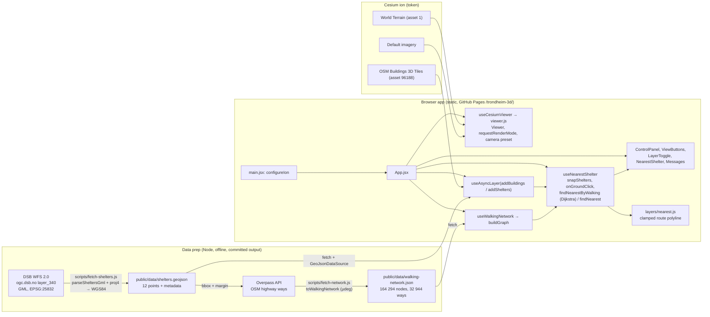

# Project 2, Trondheim 3D: report evidence

Collected 2026-10-29 by the `report-evidence` skill. Source material, not prose.

Markers:
- **[re-run]**: confirmed by running code on 2026-10-29 on the development machine (Windows 11, Node 24.20.0). The analysis numbers come from a scratch script `p2-analysis.mjs` in the session scratchpad, which is not committed. It imports `src/utils/network.js` and `src/utils/nearest.js` and reads the two committed datasets.
- **[docs]**: taken from `README.md`, `CLAUDE.md` or commit messages and not re-run.
- **UNVERIFIED**: could not be confirmed.

Paths are relative to `Project 2/` unless they start with `.github/`, `report/` or `../`.

## 1. Objective and motivation

- Purpose: a CesiumJS web app for exploring Trondheim in 3D: global terrain, OpenStreetMap buildings and DSB public shelters (tilfluktsrom) with click-to-inspect attributes. (`README.md` L3–4)
- The question it answers: "Where is the nearest public shelter in Trondheim, and how far is the walk?" (`../README.md` L11, the site table)
- It is a learning project for TBA4565. The scope is deliberately small, and the focus is on code quality: linting, tests, error handling and CI. (`README.md` L6–7)
- Learning goals: CesiumJS core concepts (Viewer, Camera, Entities vs Primitives, 3D Tiles, terrain and imagery, picking, styling); Trondheim open geodata (EPSG:25832, NN2000 vs ellipsoidal heights); professional frontend practice (structure, tooling, testing, CI/CD); AI-assisted development habits. (`CLAUDE.md` §About this project)
- Course framing: Project 2 is the GI Systems project of the module. (root `CLAUDE.md`; `../README.md` L11; `report/SPRINT.md` table)
- Who benefits: **missing** as an explicit statement. The stated beneficiary is the learner. My inference, not from the docs: residents and visitors looking for a public shelter.
- Scope rule: the README and CLAUDE.md say "Do NOT add features beyond this list without asking". The feature list is terrain and start view, 3D buildings, one open dataset with click-to-inspect, layer toggles and camera presets, and the nearest-shelter analysis. (`CLAUDE.md` §Features)

## 2. GIS concepts

The GI Science / GI Systems classification is my judgement. The course labels Project 2 as a whole "GI Systems".

- **CRS conversion EPSG:25832 → WGS84 (EPSG:4326).** The DSB shelters arrive in EUREF89 / UTM zone 32N and are converted to lon/lat with proj4 at data-prep time (`+proj=utm +zone=32 +ellps=GRS80 +towgs84=0,0,0,0,0,0,0`). EUREF89 is treated as WGS84, with no datum shift. GI Science. (`src/utils/crs.js`; `README.md` §Coordinate reference systems)
- **GeoJSON axis order [lon, lat] (RFC 7946).** The converter returns `[longitude, latitude]` to match GeoJSON. Coordinates are rounded to 7 decimals (≈1 cm). GI Systems. (`src/utils/crs.js` JSDoc; `src/utils/shelters.js` `COORD_DECIMALS`)
- **Ellipsoidal vs NN2000 (orthometric) heights; the geoid.** Cesium works in heights above the WGS84 ellipsoid. The camera targets use Kartverket NN2000 ground height (DTM 1 m) plus a fixed +40 m for the geoid in Trondheim. That offset is an approximation, not a geoid-model value. GI Science. (`src/config.js` L8–16; `README.md` §Coordinate reference systems, §Limitations)
- **ECEF (EPSG:4978) and local East-North-Up frames.** Camera presets store a landmark target plus heading, pitch and range. `toCameraOptions` builds the camera offset in the target's ENU frame and converts it to ECEF with `Transforms.eastNorthUpToFixedFrame`, so the landmark is centred by construction. GI Science (geodesy), applied in GI Systems. (`src/utils/camera.js`; `README.md` §Camera views; commit `ccd9750`)
- **Geodesic distance on the WGS84 ellipsoid.** Cesium `EllipsoidGeodesic` (Vincenty's method per the README) gives straight-line shelter distances and the network edge weights. Tested against GeographicLib (Karney) reference values. Heights are ignored. GI Science. (`src/utils/nearest.js`; `src/utils/network.js` `buildGraph`; `tests/nearest.test.js`)
- **Network analysis: graph model, snapping, Dijkstra's shortest path.** OSM nodes become graph nodes and way segments become undirected edges weighted by geodesic length. The click and the shelters are snapped to their nearest node, and a multi-target Dijkstra stops at the first shelter it reaches. GI Science (spatial analysis), implemented in the browser. (`src/utils/network.js`; `README.md` §Nearest shelter; commit `895a1b0`)
- **Local planar approximation for snapping.** `nearestNode` ranks nodes by `((Δlon·cos φ)² + Δlat²)`, an equirectangular approximation, for speed. GI Science. (`src/utils/network.js` `nearestNode`)
- **Straight-line vs network distance (detour index).** The panel shows both. The ratio of walking to straight-line distance was measured over a grid (see §6). GI Science. (`README.md` §Nearest shelter)
- **3D Tiles and hierarchical level of detail; screen-space error.** Cesium OSM Buildings (ion 96188) streams as 3D Tiles. `maximumScreenSpaceError` (default 16) controls tile refinement, and it was benchmarked at 16 vs 32. GI Systems. (`src/layers/buildings.js`; `src/config.js` `TILESET_SETTINGS`; `README.md` §Performance)
- **Terrain (quantized-mesh) and terrain picking.** Cesium World Terrain (ion 1). A ground click casts the camera ray through the pixel and intersects it with terrain (`Globe.pick`). GI Systems. (`src/layers/terrain.js`; `src/layers/nearest.js` `onGroundClick`)
- **Clamping to ground (height reference).** Shelter points and the route use `HeightReference.CLAMP_TO_GROUND` and `clampToGround: true`. The data has no heights, so the points drape on terrain and 3D Tiles. GI Systems. (`src/layers/shelters.js`; `src/layers/nearest.js`)
- **OGC WFS 2.0 GetFeature, GML.** The shelters are fetched from DSB's WFS (`layer_340`) with a bbox and `srsName=EPSG:25832`. The GML is parsed with fast-xml-parser. GI Systems (interoperability standards). (`scripts/fetch-shelters.js`; `src/utils/shelters.js`)
- **Overpass API / OSM tag-based extraction.** Walkable ways are selected by `highway` tag, and ways tagged `foot=no|private` or `access=no|private` are excluded. GI Systems. (`scripts/fetch-network.js`)
- **Entities vs Primitives; data sources.** Shelters are `GeoJsonDataSource` entities with InfoBox descriptions, and the buildings are a `Cesium3DTileset` primitive. GI Systems. (`src/layers/shelters.js`; `src/layers/buildings.js`; `CLAUDE.md` learning goal 1)
- **Render-on-demand (`requestRenderMode`).** The scene re-renders only on change, so code that changes the scene calls `scene.requestRender()`. GI Systems (performance). (`src/viewer.js`; `README.md` §Project Structure)
- **Data provenance and metadata.** The shelter file carries a `metadata` foreign member (RFC 7946 §6.1) with the fetch date, source, layer, source CRS and feature count, and the fetch date is shown in the on-screen credit. GI Systems / data quality. (`scripts/fetch-shelters.js`; `src/utils/credit.js`; commit `6710f32`)
- **Attribution and licensing (ODbL, NLOD 2.0, Cesium ion ToS).** Credits are kept on screen. GI Systems / geodata policy. (`README.md` §Attribution and Licences; `src/viewer.js` comment)

## 3. Data

### 3.1 DSB public shelters (Tilfluktsrom – Offentlige)
- Source: DSB (Direktoratet for samfunnssikkerhet og beredskap), WFS `https://ogc.dsb.no/wfs.ashx`, WFS 2.0.0 `GetFeature`, `typeNames=layer_340`. (`scripts/fetch-shelters.js` L12–26)
- Licence: NLOD 2.0, <https://data.norge.no/nlod/en/2.0>. On-screen credit: "Tilfluktsrom: © DSB, NLOD · data fetched 2026-10-28". (`README.md` §Attribution; `src/config.js` `SHELTERS.credit`; `src/utils/credit.js`)
- Request CRS: EPSG:25832. Bbox E 560 000–580 000 m, N 7 020 000–7 040 000 m (a fixed 20 × 20 km square, not the municipal boundary). (`scripts/fetch-shelters.js` L14–15)
- Output: `public/data/shelters.geojson`, WGS84 lon/lat, 2D points, attributes `romnr` (shelter no.), `plasser` (capacity), `adresse`. (`src/utils/shelters.js`)
- Preprocessing: GML parsed with fast-xml-parser; `gml:pos` "E N" or "E N H", with the height dropped; proj4 EPSG:25832 → WGS84 without a datum shift; rounded to 7 decimals. Members without a valid point, a whole-number `romnr` or a whole-number `plasser` are skipped and reported, and a missing address becomes "". The script refuses to write if no features are valid, or if any member was skipped (unless `--allow-skipped`). The output is formatted with Prettier. (`src/utils/shelters.js`; `scripts/fetch-shelters.js`; commits `1339b64`, `cc2b44b`)
- Committed file: fetched 2026-10-28 (UTC), 12 features, 5 268 places in total. **[re-run]** count and sum from the file. The 2026-10-27 file had the same 12 shelters; only the metadata was added on 2026-10-28. (`public/data/shelters.geojson` metadata; `README.md` §Shelters; commit `6710f32`)
- **[re-run] 2026-10-29:** the same WFS request with the committed parser returned HTTP 200, `numberMatched="12"`, `numberReturned="12"`, 0 skipped and 5 268 places, with features byte-identical to the committed file. The response was saved to the scratchpad only; the dataset was not overwritten.
- The 12 shelters (from the committed file; capacity in people):

  | romnr | capacity | address | lon, lat (WGS84) |
  | --- | --- | --- | --- |
  | 6870 | 630 | Westermannsveita 4 Tidl. Nordre gate 1 | 10.3990299, 63.4310289 |
  | 11848 | 200 | Siriusveien 10 | 10.4159861, 63.3944644 |
  | 12325 | 200 | Øvre Flatåsveg 2 A | 10.3458111, 63.372677 |
  | 12330 | 45 | Øvre Flatåsveg 16 | 10.3332241, 63.3731916 |
  | 12333 | 280 | Gamle Jonsvannsveien 12 | 10.4527231, 63.4115111 |
  | 20798 | 650 | Kjøpmannsgata 34 | 10.4022946, 63.4320783 |
  | 30667 | 220 | Olav Tryggvasons gate 28 | 10.3966156, 63.4334329 |
  | 30671 | 800 | Nedre Bakklandet 11 - 41 | 10.4035881, 63.428649 |
  | 30673 | 500 | Olav Kyrres gate 6 -Revmatismebygget - St. Olavs H | 10.3920475, 63.421146 |
  | 30677 | 780 | Østre Rosten 39 - Rostenhallen | 10.3808292, 63.3596445 |
  | 30678 | 513 | Hasselbakken 5A og 5 C | 10.4955293, 63.4368222 |
  | 48494 | 450 | Mellomveien 5 | 10.4302052, 63.4377223 |

- Known quality issues: no heights; addresses are free text, some with extra notes ("Tidl. Nordre gate 1", "-Revmatismebygget - St. Olavs H"); points are building locations, not entrances (my observation from the addresses, not checked). Positional accuracy of the source: **missing** (not documented). Whether the 20 × 20 km bbox leaves out shelters in outer parts of Trondheim kommune was not checked: **UNVERIFIED**.
- Dataset landing page or metadata record (e.g. Geonorge): **missing** from the repo.

### 3.2 OSM walking network
- Source: OpenStreetMap via the Overpass API, `https://overpass-api.de/api/interpreter`, POST with User-Agent "trondheim-3d (NTNU TBA4565 student project)". (`scripts/fetch-network.js`)
- Licence: ODbL 1.0, © OpenStreetMap contributors. On-screen credit "Walking network: © OpenStreetMap contributors, ODbL" under the nearest-shelter result. (`src/config.js` `NEAREST.network.credit`; `README.md` §Attribution)
- Query: `way["highway"~"^(footway|path|pedestrian|steps|living_street|residential|service|unclassified|road|track|cycleway|tertiary|tertiary_link|secondary|secondary_link|primary|primary_link|trunk_link)$"]["foot"!~"^(no|private)$"]["access"!~"^(no|private)$"](bbox); (._;>;); out skel qt;`. Motorways and trunk roads are excluded. (`scripts/fetch-network.js` L19–60)
- Bbox: the shelters' bounding box plus a margin of 0.01° lat and 0.02° lon (≈1.1 km N–S, ≈1 km E–W at 63.4°N). Stored bbox: S 63.3496445, W 10.3132241, N 63.4477223, E 10.5155293. (`scripts/fetch-network.js` `MARGIN`; **[re-run]** read from `public/data/walking-network.json`)
- Because `(._;>;)` returns all nodes of ways that cross the bbox, the stored network reaches past it: origin (SW corner) lon 10.285213, lat 63.346173, west of the bbox's west edge. **[re-run]** read from the file.
- Format: compact JSON. Node coordinates are integer micro-degrees (1e-6°, ≈0.1 m) relative to the SW origin, flattened; each way is a list of node indices. Only nodes used by ways are kept, and ways with fewer than 2 nodes are dropped. The README says this halves the size compared with decimal degrees (not re-measured). (`src/utils/osmNetwork.js`; `README.md` §Walking network)
- Extract: OSM data timestamp 2026-10-27T10:35:02Z; 164 294 nodes; 32 944 ways; **[re-run]** 181 441 undirected edges after graph build. File size 3 492 813 bytes (3.49 MB), 1.37 MB gzipped (level 9). **[re-run]** README says 3.5 MB / 1.4 MB.
- The script refuses to overwrite the file if Overpass returns no ways. (`scripts/fetch-network.js`)
- Known quality issues: an OSM snapshot, so missing or mistagged paths change the results; one-way rules are ignored (correct for pedestrians); barriers, stairs, opening hours and private ways are not modelled beyond the tag filter. (`README.md` §Nearest shelter, Limitations)

### 3.3 Cesium World Terrain (ion asset 1) and default imagery
- Source: Cesium ion; loaded with `Terrain.fromWorldTerrain()`. Heights are ellipsoidal (WGS84). Terms: Cesium ion Terms of Service, <https://cesium.com/legal/terms-of-service/>. (`src/layers/terrain.js`; `README.md` §Attribution)
- The default imagery (the Viewer default, from Cesium ion) is not named further in the repo: **missing**.
- Needs a Cesium ion token (`VITE_CESIUM_TOKEN`). If loading fails, the globe falls back to the smooth ellipsoid and a message is shown. (`src/viewer.js`; `src/layers/terrain.js`)

### 3.4 Cesium OSM Buildings (ion asset 96188)
- Source: Cesium ion, `createOsmBuildingsAsync`, 3D Tiles. © OpenStreetMap contributors, ODbL. (`src/layers/buildings.js`; `src/config.js`; `README.md` §Attribution)
- Quality: completeness and heights depend on OSM mappers; roof shapes are generic; not compared with Kartverket FKB building data. (`README.md` §Limitations)

### 3.5 Camera-preset reference points (one-off lookups, not datasets in the app)
- Landmark coordinates from Nominatim (© OSM contributors, ODbL): Torvet relation 4681742 (63.4303661 N, 10.3953233 E); Nidarosdomen way 417245741 (63.4269308 N, 10.3969145 E); Nedre Bakklandet way 22652739 (63.4288329 N, 10.4032895 E). (`README.md` §Camera views table; `src/config.js`)
- Ground heights from Kartverket's height API `ws.geonorge.no/hoydedata/v1/punkt`, `dtm1` source, CC BY 4.0: 9.6 m, 13.8 m, 2.7 m NN2000. Looked up 2026-10-27. **[docs]** (not re-queried)
- Target heights (ellipsoidal) = ground + aim height + 40 m: 50 m, 74 m (aim 20 m), 51 m (aim 8 m). (`src/config.js`)

### 3.6 Test fixtures
- `tests/fixtures/nearest-shelters.json`: GeographicLib 2.1.1 (geographiclib-geodesic, Karney 2013) WGS84 distances from Torvet to the first four shelters: 6870 → 199.2548 m, 11848 → 4132.8812 m, 12325 → 6890.1266 m, 12330 → 7088.5782 m. Computed 2026-10-27. (fixture `source` field)
- `tests/fixtures/overpass-river.json`: a hand-made network of a river with one bridge. (`README.md` §Nearest shelter Tests)
- `tests/fixtures/shelters.gml`, `tests/fixtures/shelters-invalid.gml`: WFS samples, including invalid members. (`tests/shelters.test.js`)

## 4. Architecture and stack

- Stack: Vite 8.3.5, React 19.3.1 (JSX, no TypeScript), CesiumJS 1.146.0 (pinned), proj4 2.22.0 and fast-xml-parser 5.11.2 (data prep), ESLint 10.13.0 with react-hooks, Prettier 3.9.10, Vitest 5.0.5, Playwright 1.64.1 (check scripts), vite-plugin-static-copy (copies the Cesium Workers/Assets/Widgets/ThirdParty). Node ≥ 24. (`package.json`; `vite.config.js`)
- Design choices: plain React with refs and no Resium, so the Cesium API stays visible; Cesium code lives in `layers/` and `viewer.js`, not in components; every async load returns `undefined` on error and posts a message; `requestRenderMode` is on. (`README.md` §Project Structure; `CLAUDE.md` §Code standards)
- Fully static: no backend and no routing API. GraphHopper was considered and rejected because the API key would be public in the bundle and the free daily quota could run out. (`README.md` §Nearest shelter "Why in the browser"; commit `895a1b0`)
- Hosting: GitHub Pages under `/trondheim-3d/`, with a relative Vite `base: './'`. Built by the root `npm run site:build` (`scripts/build-site.mjs`) and deployed by `.github/workflows/pages.yml`, which passes the repository secret `CESIUM_ION_TOKEN` as `VITE_CESIUM_TOKEN`. (`vite.config.js`; `../README.md` §Deployment; `.github/workflows/pages.yml`)
- Token security: Vite embeds the token in the bundle, so it is public by design. The production token has only the `assets:read` scope and Allowed URLs `https://progrimm.github.io`. (`README.md` §Cesium ion Token and Security; `../README.md` L49)
- Benchmark code is included only when `VITE_BENCHMARK=true`. **[re-run]** `grep -rl __benchmark dist/assets` found nothing in the normal build. (`src/hooks/useCesiumViewer.js`)

## 5. Methods and workflow

Steps in the order they were built (dates and hashes from `git log --stat -- "Project 2"`):

1. Scaffold Vite + Cesium with lint, test and CI (`7e0e823`, 2026-10-22).
2. Camera start view over Trondheim and terrain with error handling (`60c868b`, 2026-10-22).
3. OSM Buildings layer (`ba9979b`, 2026-10-22).
4. DSB shelters with click-to-inspect, fetched via WFS and converted EPSG:25832 → WGS84 (`1975640`, 2026-10-22).
5. UI: layer toggles and camera presets (`15db496`, 2026-10-22); migration to React (`0d2cba9`, 2026-10-23).
6. The 3DGS showcase was added (`db7dc70`, 2026-10-23) and then split out to Project 3 (`abd91eb`, 2026-10-27). It is no longer in Project 2.
7. Camera presets moved to target-based landmarks: Nominatim coordinates, Kartverket DTM heights + 40 m, ENU → ECEF (`ccd9750`, 2026-10-27).
8. Nearest shelter by straight-line geodesic distance, tested against GeographicLib (`0209d7b`, 2026-10-27).
9. Nearest shelter by walking distance: Overpass network, graph, snapping and Dijkstra in the browser, with a straight-line fallback (`895a1b0`, 2026-10-27).
10. Hardening: shelter provenance and fetch date in the credit (`6710f32`); invalid-WFS-attribute handling and a failed-layer check (`1339b64`); OSM Buildings SSE benchmark (`9e6c338`); contrast and a keyboard check (`326bd39`); review fixes (`cc2b44b`); benchmark re-run with stricter load detection (`8c10103`). All on 2026-10-28.
11. Website integration: home link, mobile credit fix, shared favicon, live deployment, NTNU design (`68dbf91`, `f2fe54c`, `214b1ad`, `2bc2312`, `9470ba7`, 2026-10-28).

Nearest-shelter algorithm per click (`src/utils/network.js`; `src/hooks/useNearestShelter.js`; `src/layers/nearest.js`):
1. A left click that hits no object → `camera.getPickRay` → `globe.pick` → WGS84 lon/lat. Clicks on objects open the InfoBox instead, and clicks on the sky are ignored.
2. Snap the click to its nearest network node. The shelters were snapped once, when the network loaded.
3. Multi-target Dijkstra (binary min-heap) from the click's node, stopping at the first shelter node reached.
4. Walking distance = geodesic connector from the click to its node + network path + geodesic connector from the shelter's node to the shelter.
5. Also compute the straight-line geodesic distance to that shelter for comparison. If there is no graph, or no shelter is reachable, fall back to `findNearest` (linear scan, geodesic).
6. Draw a ground-clamped polyline (`clampToGround`, default geodesic arc type) and a clamped point, and show the shelter number, address, capacity, walking distance and straight-line distance in the panel.

Reproduce (PowerShell, from `Project 2/`):
- Setup: `Copy-Item .env.example .env`, then set `VITE_CESIUM_TOKEN`; `npm ci`; `npm run dev`. (`README.md` §Getting Started)
- Data: `npm run data:shelters` (add `-- --allow-skipped` after a manual check); `npm run data:network`. (`README.md` §Scripts)
- Checks: `npm run lint`, `npm run format:check`, `npm test`, `npm run build`.
- Browser checks: `npm run build`, then `npx vite preview --port 4174`, then `node scripts/check-failed-layers.js [dir]` and `node scripts/check-accessibility.js [dir]`. (script headers)
- Benchmark: `node scripts/benchmark-buildings.js [runs=3] [sse=16,32]`. It builds to `dist/bench-sse-<v>`, serves on port 4175 and writes `results/buildings-benchmark.csv` and the screenshots. Needs the token in `.env`. (`scripts/benchmark-buildings.js` header)
- Whole site: from the repo root, `npm run site:install`, `npm run site:build`, then `scripts/preview-site.mjs`. (`../README.md` L37)

## 6. Results

### 6.1 Shelter totals
- 12 public shelters, 5 268 places in total. **[re-run]** `summarizeShelters` on the committed file gives `{count: 12, capacity: 5268}`. The live panel showed "12 public shelters · 5,268 places in total" in the 2026-10-29 browser check.

### 6.2 Nearest shelter, Node measurements (README, 2026-10-27) vs re-run (2026-10-29)

| Quantity | README [docs] | Re-run 2026-10-29 [re-run] |
| --- | --- | --- |
| Parse network JSON | 15 ms | 14 ms |
| Build graph (164 294 nodes) | 197 ms | 169 ms |
| Snap 12 shelters | 6 ms | 4.5 ms |
| One click (Torvet) | 1–3 ms | 1.8 ms |
| Torvet → nearest on foot | no. 6870, 276 m walk | no. 6870, 275.8 m walk |
| Torvet → straight line | no. 6870, 199 m | no. 6870, 199.3 m (GeographicLib fixture 199.2548 m) |

- Timings are Node on the development machine, not the browser, and vary between runs. (`README.md` L213)
- **[re-run]** Shelter-to-node snapping connectors in the current data: 1.0 m (30671) to 29.2 m (30678). All 12 shelters snap to distinct nodes, so none are merged. (p2-analysis.mjs)

### 6.3 Walking vs straight-line nearest, 30 × 30 grid
- Method: 900 points at the cell centres of a 30 × 30 grid over the shelters' bounding box (lon 10.3332241–10.4955293, lat 63.3596445–63.4377223). For each point, the walking-nearest shelter is compared with the straight-line nearest. The ratio is walking distance / straight-line distance to the walking-nearest shelter. The README does not say whether the grid used cell centres; the cell-centre version reproduces its numbers exactly, while an inclusive-endpoint grid does not (886 reachable, 157 differ, p90 1.71).
- Results, **[re-run]** identical to the README:
  - reachable: 884 of 900; no shelter reachable from 16 points
  - the walking-nearest shelter differs from the straight-line nearest at 168 of 884 reachable points (19.0 %)
  - median walk/straight ratio 1.34; 90th percentile 1.68
- The grid includes points in the fjord and the river, which snap to the nearest shore. (`README.md` L208–211)
- **[re-run]** Per-click time over the 900 grid points (Node): min 0.6 ms, median 4.5 ms, max 20.5 ms. The README's "1–3 ms" was for one click.

### 6.4 Browser checks of the nearest-shelter result
- **[docs]** 2026-10-27, dev server with a personal token, 1600 × 900 and 390 × 844: a click at Torvet gave no. 6870, a 266 m walk and 196 m straight. A click near Øya gave no. 30671 (Nedre Bakklandet), a 1.05 km walk and 844 m straight, with the route crossing Gamle Bybro. Clicking a building opened its InfoBox without running the search. No console errors. (`README.md` L215–223) The Torvet browser values differ from the Node values (276/199 m), presumably because the clicked pixel is not exactly the Torvet coordinate. That explanation is my inference.
- **[re-run]** 2026-10-29, `node scripts/check-failed-layers.js` against `vite preview` of the production build (1600 × 900, Nidarosdomen view, click at pixel 1000,450): exit code 0. The results match the README table:
  - nothing blocked: both layers ready, "12 public shelters · 5,268 places in total"; after the click, shelter no. 30671 (Nedre Bakklandet 11 - 41), "489 m along streets and paths", "335 m (geodesic)", capacity 800; no page errors
  - `shelters.geojson` blocked: toast "Shelter data could not be loaded."; shelter switch disabled ("Unavailable"); buildings ready; panel "Shelter data is unavailable."; no page errors
  - `walking-network.json` blocked: toast "Walking network unavailable: showing straight-line distances."; shelter no. 30671 at 335 m straight, no walking distance; no page errors
- Screenshot inspected (`nothing-blocked.png`, scratchpad): the cyan route from the click east of the cathedral crosses the river towards the Bakklandet shelter; the panel shows the result.

### 6.5 OSM Buildings benchmark (SSE 16 vs 32)
- Source: `results/buildings-benchmark.csv` (commit `8c10103`, 2026-10-28). Playwright Chromium 156, headless, `--use-angle=d3d11`, Windows 11, AMD Radeon 780M, Midtbyen view, 1600 × 900, 3 runs per value with a fresh context each. (`README.md` §Quality checks, §Performance)
- **Not re-run** (the benchmark overwrites the committed CSV, and the numbers are machine-specific). **[re-run]** The medians below were recomputed from the CSV and match the README table. They are column-wise medians, not the values of a single run.

  | SSE | First load | Mean fps | 5th-pct fps | Worst frame | Building tiles | JS heap |
  | --- | --- | --- | --- | --- | --- | --- |
  | 16 (kept) | 3.05 s (runs 4.78, 3.04, 3.05) | 58.7 | 51.0 | 101.3 ms | 26.8 MiB | 190 MiB |
  | 32 | 3.19 s (runs 3.19, 3.29, 3.14) | 58.7 | 48.5 | 103.7 ms | 17.9 MiB | 141 MiB |

- Frames per 10 s orbit: 566–596. Tile memory at SSE 32 is 33.5 % lower (17.86 / 26.84 MiB). **[re-run]** from the CSV.
- Decision: keep SSE 16. Frame rate is capped near the 60 Hz display, and first load is dominated by the network. The screenshots `results/buildings-sse-16.png` and `results/buildings-sse-32.png` show many small buildings in Midtbyen missing at SSE 32. (`README.md` L366–372) Screenshot comparison: **[docs]**, not inspected in this session.
- An earlier run on 2026-10-28 with a looser load condition gave 5.27 s vs 3.28 s and was superseded. (`README.md` L374–377; commit `8c10103`)
- Definitions: first load = navigation → `globe.tilesLoaded`, `tileset.tilesLoaded` and World Terrain replacing the ellipsoid, stable for 4 polls of 50 ms; 5th-percentile fps = 1000 / 95th-percentile frame time (nearest rank, `src/utils/frameStats.js`, unit-tested).

### 6.6 Accessibility and contrast
- **[re-run]** 2026-10-29, `node scripts/check-accessibility.js` (exit 0, no FAIL lines), `reducedMotion: 'reduce'`:
  - desktop tab order: Cesium credit links ("Upgrade for commercial use.", "Data attribution"), "← My GIS module", "Hide controls", Midtbyen, Nidarosdomen, Bakklandet, Buildings, Public shelters; every stop has an outline
  - mobile (390 × 844): collapsed panel stops are "← My GIS module" then "Show controls"; after Enter, all five controls are reachable
  - Space toggled the Buildings switch (true → false) at both widths
  - Screenshot `keyboard-mobile.png` inspected: the bottom sheet is open with a focus ring on "Public shelters". The open sheet covers the Cesium credit line, a documented limitation.
- Contrast, computed with the WCAG formula from the `src/style.css` tokens (`--surface` white at 94 % over black → rgb(240 240 240)). **[re-run]**: text #0f2a47 12.74:1 (README 12.8:1, a rounding difference), muted #44607f 5.70:1, NTNU blue #00509e 6.96:1 (README 7.0:1), white on the InfoBox navy at 95 % over a white backdrop 12.61:1 (README 12.6:1). The 1.26:1 for the old switch track was not re-computed. These are computed values, not on-screen measurements. (`README.md` L387–397)

### 6.7 Mobile credits fix
- **[docs]** Playwright at 390 px: the credits end at y = 736 and the sheet starts at y = 741 (collapsed sheet 103 px). The cause was Cesium's `Viewer.resize()` writing an inline `bottom` (CesiumJS 1.146.0). (`README.md` L487–491; commit `68dbf91`) Not re-measured.

### 6.8 Deployment
- **[docs]** Live 2026-10-28 at <https://progrimm.github.io/TBA4565-Geomatics-Specialization-Course/trondheim-3d/>. Pages run 40763110583 and Project 2 CI run 40763110659 passed. Round trip at 1600 and 390 px with no console errors or failed requests. `api.cesium.com` answered HTTP 200 for the Pages origin and HTTP 403 for `https://example.com`. (`README.md` L498–504; commit `2bc2312`)
- **[re-run]** 2026-10-29: the live `/trondheim-3d/` and `/trondheim-3d/data/shelters.geojson` return HTTP 200, and the live file has `"fetched": "2026-10-28"`. The live CSS asset (`index-Bu-LG3pb.css`) has the same hash as a local build of HEAD, so the NTNU design is deployed. The JS hash differs, as expected, because the embedded token differs.
- CI run status for HEAD `10dcd34` [re-run via the public GitHub REST API, 2026-10-29]: Project 2 CI success (https://github.com/progrimm/TBA4565-Geomatics-Specialization-Course/actions/runs/40766317062); Pages deploy success (runs/40766317129). Earlier run links are in the README.

### 6.9 Build output
- **[re-run]** `npm run build`: `dist/assets/index-*.js` 4 415.58 kB (1 195.88 kB gzip), CSS 29.21 kB (6.70 kB gzip); Vite warns that the chunk is larger than 500 kB; 342 Cesium static files copied.

## 7. Verification

- **[re-run]** 2026-10-29, from `Project 2/`:
  - `npm run lint`: exit 0
  - `npm run format:check`: "All matched files use Prettier code style!"
  - `npm test`: 11 test files, 54 tests passed
  - `npm run build`: exit 0
- Unit tests (`tests/`, Vitest, Node environment):
  - `nearest.test.js`: geodesic distances vs the textbook WGS84 values (1° lon at the equator 111 319.4908 m; meridian arc 0–1° 110 574.3886 m) and the GeographicLib fixture, with `toBeCloseTo(…, 3)`, i.e. |Δ| < 0.5 mm; symmetry; zero for identical points; nearest search, including an empty list and order independence; totals; formatting
  - `network.test.js`: compact encoding, graph decoding, geodesic edge weights, Dijkstra around the river via the bridge, a zero-length path, unreachable targets, walking-nearest vs straight-line-nearest, connectors
  - `shelters.test.js`: GML parsing and UTM → WGS84 rounding; the invalid fixture (no geometry, a 1-number position, an empty or non-numeric capacity "ca. 200", no `romnr`, a missing address, a feature from another layer); a 3D position; a non-FeatureCollection response
  - `crs.test.js`: zone 32 origin (500 000, 0) → 9°E, 0°N; shelter 6870 lands in central Trondheim
  - `camera.test.js`: the camera is exactly `range` from the target, raised by range·sin|pitch|, south of the target for heading 0, west for heading 90; radians
  - also: `credit.test.js`, `frameStats.test.js`, `motion.test.js` (reduced motion → duration 0), `html.test.js` (escaping), `messages.test.js`, `smoke.test.js` (presets inside a Trondheim bbox)
- Test count history: 14 → 19 → 31 → 42 → 54. (`README.md` §Status)
- CI: `.github/workflows/project2-ci.yml` runs `npm ci`, lint, format:check, test and build on ubuntu-latest with Node 24, on pushes to main and on PRs touching `Project 2/**`. The Playwright checks and the benchmark are **not** in CI; they run locally. (workflow file)
- Browser checks: see §6.4 and §6.6. Both scripts re-ran with exit 0 against the production build with the local development token. The camera presets were checked with crosshair screenshots at 1600 × 900 and 390 × 844 on 2026-10-27 **[docs]** (`README.md` L147–152); not re-run.
- Not verified (per the README): screen-reader behaviour, Firefox and Safari, performance on a phone. (`README.md` L479–480)

## 8. Limitations, assumptions and uncertainties

Acknowledged in the docs (`README.md` §Limitations, §Nearest shelter):
- Heights are ellipsoidal. The +40 m geoid offset is an approximation, not a geoid-model value, so a height read from the app is not an NN2000 height.
- EUREF89 is treated as WGS84 (no datum shift; the README says the difference is under a metre). The size of the difference was not computed in the repo: **UNVERIFIED**.
- OSM building completeness and heights depend on mappers; roofs are generic; no comparison with FKB.
- The network is an OSM snapshot. One-way rules are ignored. Barriers, stairs and opening hours are not considered.
- Snapping uses the nearest node, not the nearest point on an edge. The connectors are straight and can cross buildings or water.
- Two shelters on the same node are merged (none are in the current data, **[re-run]**).
- The network adds a 3.5 MB download (1.4 MB gzipped).
- Keyboard users cannot run the nearest-shelter search, because it needs a map click.
- On mobile, the result is visible only while the sheet is open, and the open sheet covers the credits.
- The search also runs when the shelter layer is hidden.
- The benchmark covers one machine, one view, headless Chromium, and a frame rate capped at 60 Hz.

Spotted in the code (not stated in the docs):
- Edge weights are 2D ellipsoidal lengths. Slope and elevation are ignored (heights are not used), although parts of Trondheim are hilly. (`src/utils/network.js` `buildGraph` uses height 0)
- The analysis ignores capacity: it picks the nearest reachable shelter regardless of its places (5 268 places in total) and does not allocate demand. (`src/utils/network.js` `findNearestByWalking`)
- Snapping and the click's own node use the planar approximation over all 164 294 nodes (linear scan per click). There is no spatial index, though this is fast enough per the measurements. (`nearestNode`)
- Clicks in the fjord or river snap to the nearest shore node. Clicks far outside the network bbox still snap to the nearest edge node, with a long straight connector. (code; grid observation in `README.md`)
- 16 of 900 grid points reached no shelter. Disconnected network components are the likely cause (my inference; not investigated).
- The shelter bbox is a fixed 20 × 20 km square in UTM32, not the municipal boundary. Coverage of all of Trondheim kommune is **UNVERIFIED**.
- Shelter heights from the WFS (if any) are dropped, and the points are clamped to terrain. (`src/utils/shelters.js`)
- The straight-line comparison is a surface geodesic, not a 3D distance. (`src/utils/nearest.js` JSDoc)
- The ground click intersects terrain only (`globe.pick`). A click on a building is consumed by the InfoBox (`scene.pick`), so a start point on a building footprint cannot be chosen. (`src/layers/nearest.js`)
- The camera heading and pitch are applied at the camera, not the target. The code comment says the curvature error is < 0.05° over a few km (not tested). (`src/utils/camera.js` JSDoc)
- The Cesium ion token is public in the bundle. This is mitigated by the Allowed URLs restriction, which was verified on 2026-10-28 **[docs]**.
- The production JS bundle is a single 4.4 MB chunk (1.2 MB gzip) **[re-run]**; there is no code splitting.
- The browser checks and the benchmark depend on live Cesium ion and network conditions and are not in CI.
- **FIXED 2026-10-29** (the line now notes it was superseded). Doc inconsistency: the `CLAUDE.md` hardening line still says "panel surface 85 % for contrast", which the NTNU design (94 % white) superseded. The `CLAUDE.md` NTNU-design line and the README are current. (`CLAUDE.md` §Current status; `src/style.css` `--surface`)

## 9. Future work

- Explicit future-work list: **missing** in the Project 2 docs.
- Implied by the stated limitations (README), not planned anywhere: keyboard-accessible start point for the search; showing the result while the mobile sheet is collapsed; disabling the search when the shelter layer is hidden; a real geoid model instead of the fixed +40 m; comparing the buildings with FKB; snapping to edges instead of nodes; modelling barriers, stairs and access; testing in Firefox, Safari, on a phone and with a screen reader. (`README.md` §Limitations, §Status "Not verified")
- Out of scope by rule: "Do NOT add features beyond this list without asking." (`CLAUDE.md` §Features)

## 10. References

Cited in the repo:
- CesiumJS reference docs: `Transforms.eastNorthUpToFixedFrame` <https://cesium.com/learn/cesiumjs/ref-doc/Transforms.html#.eastNorthUpToFixedFrame>; `Globe.pick` <https://cesium.com/learn/cesiumjs/ref-doc/Globe.html#pick>; `EllipsoidGeodesic` <https://cesium.com/learn/cesiumjs/ref-doc/EllipsoidGeodesic.html>; `GeoJsonDataSource.load` <https://cesium.com/learn/cesiumjs/ref-doc/GeoJsonDataSource.html#.load>; `Cesium3DTileset.maximumScreenSpaceError` <https://cesium.com/learn/cesiumjs/ref-doc/Cesium3DTileset.html#maximumScreenSpaceError>; `tilesLoaded` <https://cesium.com/learn/cesiumjs/ref-doc/Cesium3DTileset.html#tilesLoaded>; `totalMemoryUsageInBytes` <https://cesium.com/learn/cesiumjs/ref-doc/Cesium3DTileset.html#totalMemoryUsageInBytes>; `Scene.preRender` <https://cesium.com/learn/cesiumjs/ref-doc/Scene.html#preRender>. (`README.md`)
- Cesium ion: <https://ion.cesium.com/>; tokens <https://ion.cesium.com/tokens>; access tokens guide <https://cesium.com/learn/ion/cesium-ion-access-tokens/>; Terms of Service <https://cesium.com/legal/terms-of-service/>. (`README.md`; `../README.md`)
- GeographicLib (Karney's algorithm), version 2.1.1 used for the fixture: <https://geographiclib.sourceforge.io/>. (`README.md` L187)
- RFC 7946 GeoJSON, §6.1 foreign members: <https://datatracker.ietf.org/doc/html/rfc7946#section-6.1>. (`README.md` L269)
- Nominatim: <https://nominatim.openstreetmap.org/>. Kartverket height API `ws.geonorge.no/hoydedata/v1/punkt` (dtm1, CC BY 4.0). (`README.md` L141–143)
- DSB WFS: <https://ogc.dsb.no/wfs.ashx> (GetCapabilities answered HTTP 200 on 2026-10-29). Overpass API endpoint: <https://overpass-api.de/api/interpreter>. (`scripts/`)
- Licences: ODbL <https://opendatacommons.org/licenses/odbl/>; NLOD 2.0 <https://data.norge.no/nlod/en/2.0>. (`README.md` §Attribution)
- Playwright `page.route` <https://playwright.dev/docs/api/class-page#page-route>; `reducedMotion` <https://playwright.dev/docs/api/class-browser#browser-new-context-option-reduced-motion>. (`README.md`)
- WCAG 2.2 contrast minimum <https://www.w3.org/WAI/WCAG22/Understanding/contrast-minimum.html>; non-text contrast <https://www.w3.org/WAI/WCAG22/Understanding/non-text-contrast.html>. (`README.md`)
- GitHub Pages custom workflows <https://docs.github.com/en/pages/getting-started-with-github-pages/using-custom-workflows-with-github-pages>; `actions/upload-pages-artifact` <https://github.com/actions/upload-pages-artifact>; `actions/deploy-pages` <https://github.com/actions/deploy-pages>. (`../README.md` L43)

Clearly relevant but not cited in the repo (each URL returned HTTP 200 on 2026-10-29 unless noted):
- Karney, C. F. F. (2013). Algorithms for geodesics. *Journal of Geodesy* 87, 43–55. <https://doi.org/10.1007/s00190-012-0578-z> (the fixture names "Karney 2013")
- Vincenty, T. (1975). Direct and inverse solutions of geodesics on the ellipsoid with application of nested equations. *Survey Review* 23(176), 88–93. <https://doi.org/10.1179/sre.1975.23.176.88> (the README names "Vincenty's method"; the DOI returned HTTP 403 to the automated check, so it was not confirmed)
- Dijkstra, E. W. (1959). A note on two problems in connexion with graphs. *Numerische Mathematik* 1, 269–271. <https://doi.org/10.1007/BF01386390>
- OGC Web Feature Service standard: <https://www.ogc.org/standards/wfs/>
- 3D Tiles specification: <https://github.com/CesiumGS/3d-tiles>
- Cesium OSM Buildings: <https://cesium.com/platform/cesium-ion/content/cesium-osm-buildings/>; Cesium World Terrain: <https://cesium.com/platform/cesium-ion/content/cesium-world-terrain/>
- EPSG:25832: <https://epsg.io/25832>; proj4js: <https://github.com/proj4js/proj4js>
- Overpass API (OSM wiki): <https://wiki.openstreetmap.org/wiki/Overpass_API>; OSM `highway` key: <https://wiki.openstreetmap.org/wiki/Key:highway>
- An NN2000 / geoid reference (Kartverket): **missing**. The URL I tried returned 404 and was dropped.
- A DSB / Geonorge metadata record for "Tilfluktsrom – Offentlige": **missing**.
